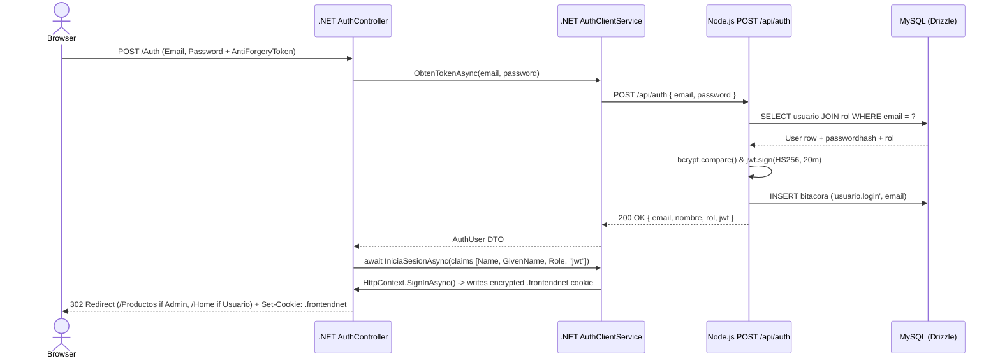
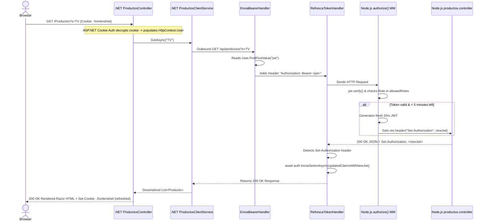
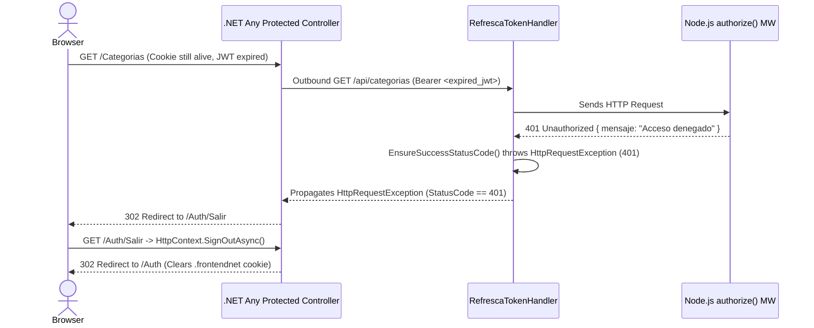
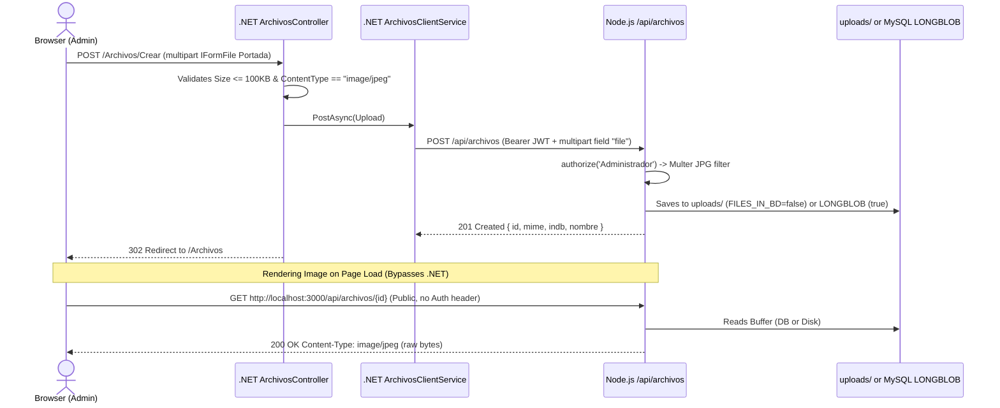

# System Architecture, Stack Assessment & Component Communication

This document evaluates the full-stack architecture combining the **Node.js Backend (`backendnode`)** and the **ASP.NET Core 8.0 MVC Frontend (`frontendnet`)**, compares the **Original Unmodified Stack** against the **Modified Stack**, catalogs technical issues to resolve, and defines the exact runtime communication flows between all components.

---

## 1. Verdict: Original Unmodified Stack vs. Modified Stack

| Layer | Original Unmodified Stack (PDFs) | Modified Stack (Current Spec) | Winner |
| :--- | :--- | :--- | :--- |
| **Backend Language** | Plain JavaScript (CommonJS) | TypeScript (`strict: true`) | **Modified** |
| **Backend ORM** | Sequelize v6 (Models + manual Migrations) | Drizzle ORM (`mysql2` pool, single TS schema) | **Modified** |
| **Validation & API Docs** | `express-validator` + `swagger-autogen` (OAS 2.0) | Zod + `drizzle-zod` + `@asteasolutions/zod-to-openapi` (OAS 3.0.3) + Swagger UI + Scalar | **Modified** |
| **Frontend Runtime** | ASP.NET Core 8.0 MVC + Razor + Cookie Auth | ASP.NET Core 8.0 MVC + Razor + Cookie Auth *(with PDF bugs fixed & optional Kiota/Refitter client)* | **Modified (Hardened)** |
| **Database** | MySQL 8.0 (`mercadolibrenode`, `utf8mb4`) | MySQL 8.0 (`mercadolibrenode`, `utf8mb4`) | **Tie (Identical)** |

### Was the Original Stack Better or Worse?
**Overall, the original unmodified stack was significantly worse for real-world engineering and AI-agent collaboration—and only marginally better for strict classroom-rubric checkbox matching.**

* **Why the Modified Stack is Better:**
  1. **Matches C#'s Type Rigor on the Backend:** In the original stack, you had a strongly typed C# frontend talking to an untyped JS backend with no shared schema. That asymmetry caused silent bugs (such as `.NET` sending `"archivoId"` while Node expected `"archivoid"`). Adding **TypeScript + Drizzle + Zod/OpenAPI 3.0.3** gives both sides compile-time verification (`tsc --noEmit` and `dotnet build`) and a machine-readable contract (`/openapi.json`).
  2. **Eliminates Silent Runtime Failures:** The original JS + Sequelize backend had multiple unguarded crashes (`rolusuario.id` null dereference, `data.protegido` null dereference, `archivo.update()` returning `[affectedRows]` instead of `data.id` for `bitacora`). TypeScript + Drizzle makes these impossible to ship.
  3. **Faster, Leaner, Better for Agents:** Agents working in Antigravity rely heavily on compiler feedback loops. Running `npm run typecheck` + `dotnet build` catches cross-layer regressions immediately without needing manual clicks in a browser.
* **Where the Original Stack Had an Edge (Narrowly):**
  1. **Zero Academic Rubric Friction:** If an instructor grades strictly by inspecting whether `sequelizemeta` exists in MySQL or whether files end in `.js`, the unmodified stack avoids having to justify modernizations.
  2. **Slightly Simpler Tooling:** No `tsconfig.json`, `tsx`, or OpenAPI schema registration step for absolute beginners.

---

## 2. Problems in the Stack (Architectural & Cross-Stack Risks)

Even after upgrading the backend to TypeScript + Drizzle, the **overall two-server architecture** has inherent trade-offs and subtle cross-stack pitfalls that all agents must understand:

### A. Cross-Stack Contract & Serialization Issues
1. **`archivoId` vs `archivoid` Casing Mismatch (CRITICAL):**
   * .NET's `PostAsJsonAsync` / `PutAsJsonAsync` serializes C# PascalCase properties to **camelCase** (`ArchivoId` → `"archivoId"`).
   * The backend DB and original spec use **all-lowercase** (`archivoid`).
   * **Fix:** Add `[JsonPropertyName("archivoid")]` in C# `Producto.cs` (or generate the C# client from `/openapi.json`), AND optionally normalize/accept `archivoid` explicitly in the backend Zod schema.
2. **MySQL `DECIMAL(10,2)` String vs. Number Serialization:**
   * `mysql2` returns `DECIMAL` columns as strings (`"13080.00"`) to avoid IEEE-754 floating-point drift.
   * `GetFromJsonAsync` tolerates string-encoded numbers via `JsonSerializerDefaults.Web`, **but** strict OpenAPI validators and generated SDKs (like Kiota) expect a JSON `number` if OpenAPI declares `type: number`.
   * **Fix:** Explicitly decide in `productos.schema.ts` whether `precio` is serialized as JSON `number` (`Number(row.precio)`) and document it identically in OpenAPI 3.0.3.
3. **Mismatched File Upload Limits (100 KB vs. Unlimited):**
   * `ArchivosController` rejects files `> 100 KB`, while `backendnode`'s Multer middleware enforces no file size cap. Any direct API client (Postman, Swagger, C# script) can bypass the frontend limit and upload massive blobs into MySQL `LONGBLOB`.
   * **Fix:** Configure `limits: { fileSize: 100 * 1024 }` (or a documented limit) in `upload.middleware.ts` on the backend too.

### B. Security & Session Architecture Problems
4. **`async void` Cookie Sign-In Race Condition (CRITICAL in PDF):**
   * The original `AuthClientService.IniciaSesionAsync` is `async void`, meaning `AuthController` and `RefrescaTokenDelegatingHandler` do not `await` cookie creation/refresh. Under real latency, the response redirects before the `Set-Cookie` header is written.
   * **Fix:** Change to `public async Task IniciaSesionAsync(...)` and `await` it.
5. **Concurrent Request Token-Refresh Race:**
   * If a user triggers two parallel requests to `.NET` when `< 5 minutes` remain on the JWT, both outbound requests receive `Set-Authorization` from Node.js and both re-write the `.frontendnet` cookie. While benign for stateless HS256 JWTs (both new tokens are valid), it's worth noting if token revocation/blacklisting is ever added later.
6. **Raw JWT Exposure in `/Perfil` View:**
   * The BFF Cookie pattern's main security benefit is keeping the JWT **hidden from browser JavaScript** (XSS protection). However, `Views/Perfil/Index.cshtml` intentionally renders `@Model.Jwt` into the HTML page for classroom demonstration.
   * **Recommendation:** Keep it if required for grading/debugging, or hide it behind `IWebHostEnvironment.IsDevelopment()`.
7. **Direct Browser-to-Backend Image Coupling:**
   * `` causes the **browser** to fetch images directly from Node.js (`:3000`), bypassing the `.NET` server (`:8080`).
   * **Consequences:**
     * `GET /api/archivos/:id` **must remain public** (no Bearer token), since `` tags cannot send custom `Authorization` headers.
     * In Docker/Kubernetes, internal DNS (`http://backend:3000`) will not resolve in the user's browser; hence the need to separate `UrlWebAPI` (server-to-server) from `PublicUrlWebAPI` (browser-facing).
8. **Missing Client IP Forwarding (`request-ip`):**
   * Because `.NET` makes server-to-server HTTP requests to Node.js, `requestIp.getClientIp(req)` on Node.js will log `127.0.0.1` / `::1` (the `.NET` server's IP) instead of the end user's browser IP in `bitacora` and `log/log.txt`.
   * **Fix (Optional Upgrade):** In `EnviaBearerDelegatingHandler`, forward the browser's IP via `X-Forwarded-For` header from `HttpContext.Connection.RemoteIpAddress`.

### C. Operational & UI Limitations
9. **Polyglot Deployment Overhead:** Running both Node.js and ASP.NET Core 8.0 requires two runtimes, two healthchecks, and coordinated port/CORS management.
10. **CDN Reliance & Stubbed Storefront:** All CSS/JS relies on external CDNs (`cdnjs`, `jsdelivr`), and the customer-facing `Carrito`, `Comprar` action button, and `Crear cuenta` self-registration are unimplemented placeholders.

---

## 3. Component Communication Architecture

### 3.1 High-Level System Topology

```mermaid
flowchart LR
    subgraph Browser["User Browser (Client)"]
        UI["HTML / Bootstrap 5 / jQuery"]
        Cookie[("Encrypted Cookie\n.frontendnet\n(Claims + JWT)")]
    end

    subgraph DotNet["Frontend Server — ASP.NET Core 8.0 MVC (:8080)"]
        Razor["MVC Controllers\n& Razor Views"]
        AuthMW["Cookie Auth Middleware\n(20m Sliding)"]
        Services["Typed HttpClient Services"]
        H1["EnviaBearerDelegatingHandler\n(Adds Authorization: Bearer)"]
        H2["RefrescaTokenDelegatingHandler\n(Reads Set-Authorization -> Re-signs Cookie)"]
    end

    subgraph Node["Backend API — Node.js / TS / Express (:3000)"]
        Express["Express Pipeline\n(CORS + JSON + Bitacora MW)"]
        JWTMW["authorize() Middleware\n(Verify HS256 + RBAC + <5m Refresh)"]
        Controllers["TS Controllers + Zod Validation"]
        Drizzle["Drizzle ORM (mysql2 Pool)"]
        Disk[("uploads/ & log/log.txt")]
        OpenAPI["/openapi.json\n/swagger & /docs"]
    end

    DB[("MySQL 8.0\nmercadolibrenode")]

    UI <-->|"HTTP HTML / Form POST\nCookie: .frontendnet"| AuthMW
    AuthMW <--> Razor
    Razor --> Services
    Services --> H1 --> H2
    H2 <-->|"Server-to-Server JSON / Multipart\nAuthorization: Bearer & Set-Authorization"| Express
    UI -.->|"Direct Public <img> GET\n/api/archivos/:id (No Auth)"| Express

    Express --> JWTMW --> Controllers
    Controllers --> Drizzle <--> DB
    Controllers <--> Disk
    Express --- OpenAPI
```

---

### 3.2 Sequence 1: Login & Cookie-to-JWT Bridge Establishment

---

### 3.3 Sequence 2: Authenticated Request & Sliding JWT Refresh (< 5 min remaining)

---

### 3.4 Sequence 3: Expired / Rejected Token Auto-Logout Flow

---

### 3.5 Sequence 4: Image Upload (Multipart) & Direct Public Image Rendering

---

## 4. Recommended Integration Strategy for Your Agents

1. **Keep the Backend on TypeScript + Drizzle + Zod/OpenAPI 3.0.3** (`SOFTWARE_SPECIFICATION.md`).
2. **Keep the Frontend on ASP.NET Core 8.0 MVC** (`FRONTEND_SPECIFICATION.md`), applying all 11 mandatory PDF bug fixes.
3. **Align the Contract:** Start the Node.js server first so `http://localhost:3000/openapi.json` is live. Your frontend agent can either:
   * Use the clean hand-written typed `HttpClient` services from `FRONTEND_SPECIFICATION.md` (with `[JsonPropertyName("archivoid")]` fixed), **or**
   * Generate the low-level client via **Microsoft Kiota** / **Refitter** from `/openapi.json` and wrap it behind the existing `*ClientService` classes so Controllers and Views remain untouched.